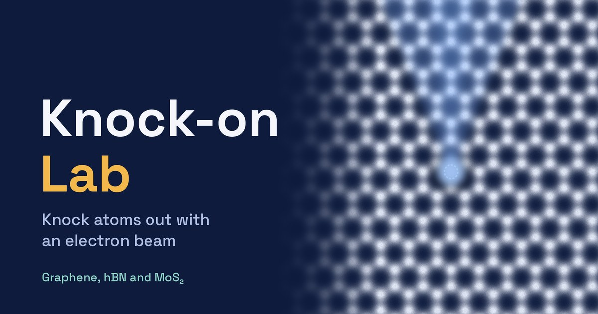

# Knock-on Lab

[](https://doi.org/10.5281/zenodo.23105637)

An educational browser game about electron-beam knock-on damage in scanning transmission electron microscopy (STEM). Pick a 2D crystal (graphene, hBN or MoS₂), set up the microscope and find out when the beam knocks an atom out of the lattice.

Available in English, Spanish and Portuguese, with a step-by-step tutorial for first-time players and three interface styles: the game's own console, a TIA-style layout and a Velox-style layout. The TIA- and Velox-style layouts imitate the look of electron-microscope software for teaching; Knock-on Lab is not affiliated with or endorsed by Thermo Fisher Scientific, and TIA and Velox are its trademarks.

**Play:** https://knockonlab.netlify.app



## For teachers
Runs in any modern browser, on desktop or mobile, with no installation or sign-up.

## Run locally
Open `index.html` in a browser, or serve the folder with
```
python -m http.server 8000
```
and go to http://localhost:8000.

## Author
Luis E. Piedra ([ORCID 0000-0001-8598-8529](https://orcid.org/0000-0001-8598-8529))  
International Iberian Nanotechnology Laboratory (INL), Braga, Portugal  
Instituto Superior Técnico, Universidade de Lisboa, Lisboa, Portugal

## How to cite
Piedra Marin, L. E. (2026). *Knock-on Lab: an educational browser game on electron-beam knock-on damage in 2D materials* [Computer software]. Zenodo. https://doi.org/10.5281/zenodo.23105637

This DOI always points to the latest version. To cite v1.0.0 specifically, use https://doi.org/10.5281/zenodo.23105638. GitHub's *Cite this repository* button also gives APA and BibTeX.

## License
From v1.1.0 onwards, Knock-on Lab is released under the [PolyForm Noncommercial License 1.0.0](https://polyformproject.org/licenses/noncommercial/1.0.0) (see `LICENSE`). You may use, copy and modify it for any noncommercial purpose, including teaching and research at schools, universities and public research organisations, as long as you keep the copyright notice. Commercial use requires the author's permission.

Versions v1.0.0 to v1.0.2 were released under the MIT License, and those releases remain under MIT.
